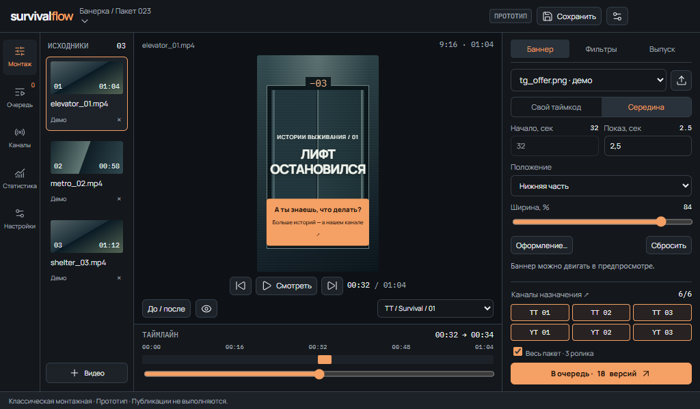
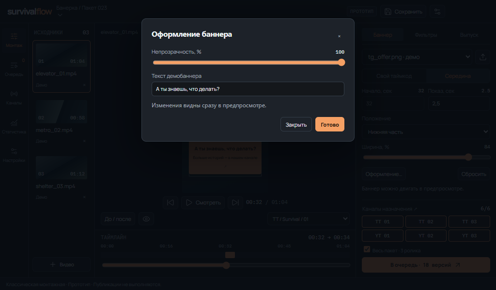
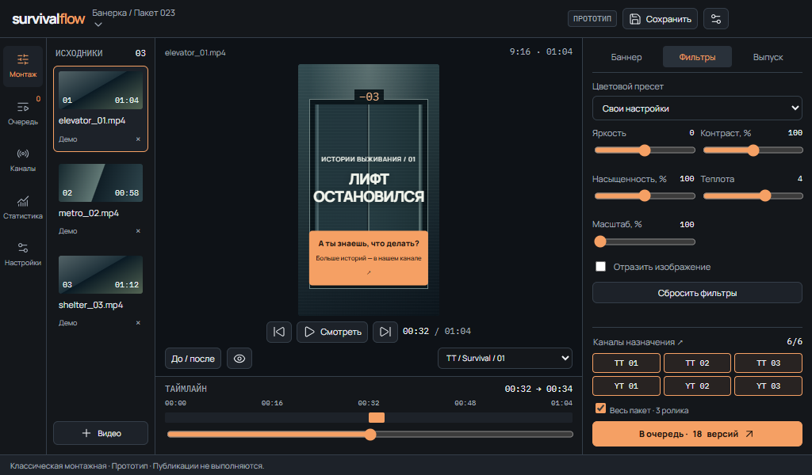
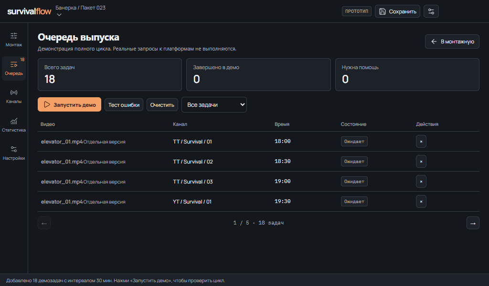
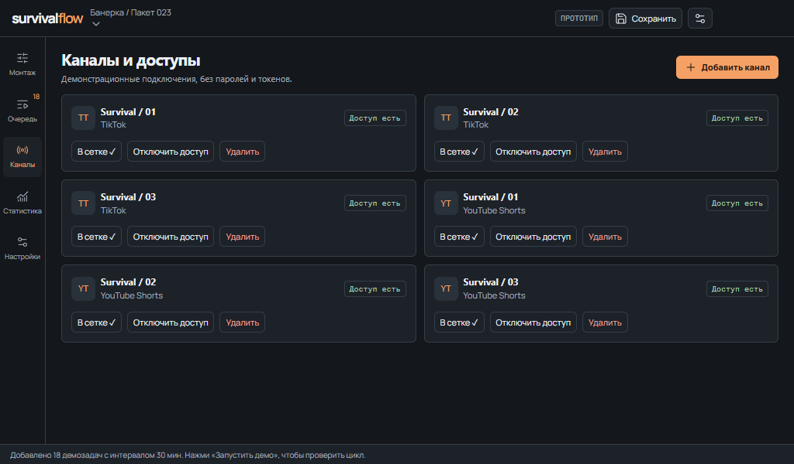
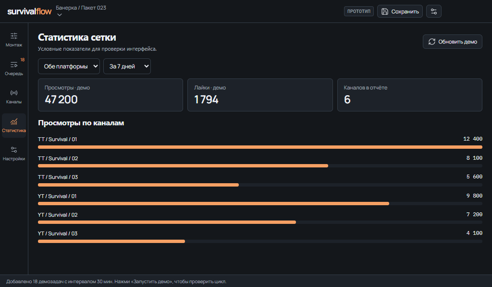
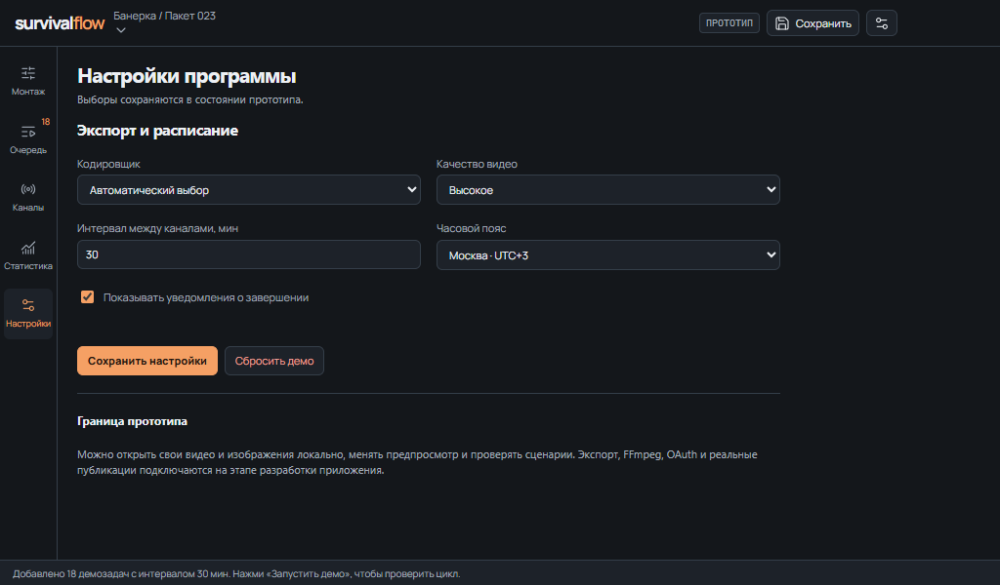

# SurvivalFlow: дизайн классической «Монтажной»

Версия: **1.0**. Зафиксировано: **23 октября 2026 года**.
Статус: **утверждённое пользователем направление и компоновка; эталон для реализации**.

## 1. Назначение и границы

Локальное рабочее приложение для подготовки и публикации готовых роликов из проекта «Банерка». Основной сценарий: загрузить исходники и рекламный баннер, настроить вставку, проверить варианты, выбрать каналы, поставить пакет в очередь и посмотреть результаты.

Базовый объём: 3 исходника, 3 TikTok-аккаунта и 3 YouTube-канала, 18 публикаций за день.

Пользователь выбрал **только классическую тёмную «Монтажную»** и потребовал разместить рабочий интерфейс на одном экране. Другие ранее показанные компоновки не являются вариантами для дальнейшей разработки.

Этот документ фиксирует внешний вид, взаимодействия и критерии переноса в React. Он не означает, что backend, экспорт, авторизация или реальные публикации уже реализованы.

## 2. Эталон и порядок изменений

Эталон версии 1.0 хранится рядом с этим документом:

- [Интерактивный эталон в браузере](assets/design-v1/preview.html).
- [Исходный фрагмент прототипа](assets/design-v1/classic-compact.html).
- [Контрольные суммы и перечень файлов](assets/design-v1/manifest.json).
- [Машиночитаемые токены и размеры](assets/design-v1/design-tokens.json).
- Изображения разделов — в `assets/design-v1/`.

Фрагмент содержит демонстрационную логику. Отдельная HTML-обёртка позволяет просмотреть его вне чата. Шрифты эталона загружаются извне; для рабочего приложения требуется обеспечить стабильное отображение Manrope и IBM Plex Mono, включая кириллицу.

При переносе действуют три уровня требований:

1. Договорённости пользователя: классическая компоновка, тёмный стиль, редактор на одном экране.
2. Эта спецификация: геометрия, цвета, элементы, состояния и поведение.
3. Эталонные файлы: конкретная отрисовка текущего прототипа.

Небольшие исправления читаемости, длинных названий и реальных состояний допустимы в рамках этой композиции. Перестановка основных областей, новая палитра или возврат альтернативной компоновки требуют нового решения пользователя.

Изменения дизайна фиксируются новой версией спецификации и записью в журнале. Эталон `design-v1` не перезаписывается молча.

## 3. Характер интерфейса

Сдержанная рабочая среда видеоредактора: графитовые поверхности, тонкие разделители, тёплый оранжевый акцент, компактные органы управления. Визуальный центр — вертикальное видео с баннером, а основное действие — подготовка пакета к публикации.

Плотность достигается разделением настроек по вкладкам и использованием дополнительного диалога. Читаемость, названия действий и доступ к параметрам сохраняются.

В редакторе нет приветственного hero-блока, больших декоративных метрик, иллюстраций вне видео или длинной ленты настроек. Сводные показатели появляются в очереди и статистике, где они объясняют результат работы.

## 4. Геометрия одного экрана

### 4.1. Базовая рабочая область

Целевая минимальная desktop-область приложения: **1024×600 CSS px** при масштабе браузера 100%. Это размер содержимого приложения; панели операционной системы и браузера в него не входят.

Эталон имеет высоту 600 px. Внутри этой области должны быть доступны обязательные действия без вертикальной прокрутки документа и вложенных панелей. Нельзя достигать этого обрезанием содержимого через `overflow: hidden`.

Проверенные ширины прототипа: 1366, 1024 и 736 px. Ширина 736 px — дополнительный компактный режим; основная desktop-приёмка проводится от 1024 px.

| Область | Размер в базовом desktop-режиме |
| --- | --- |
| Верхняя панель | Высота 48 px |
| Основная рабочая часть | Высота 526 px |
| Нижняя строка состояния | Высота 26 px |
| Левая навигация | Ширина 59 px |
| Исходники | Ширина 137 px |
| Инспектор справа | Ширина 290 px |
| Центр | Всё оставшееся пространство; при общей ширине 1024 px — 538 px |
| Таймлайн | Высота 99 px, только под центральным предпросмотром |

```text
┌───────────────────────────────────────────────────────────────────┐
│ Логотип · пакет                         Сохранить · настройки     │ 48
├──────┬───────────┬─────────────────────────────┬────────────────────┤
│      │           │ Имя файла, формат           │ Баннер / Фильтры / │
│      │ Исходники │                             │ Выпуск             │
│ Раз- │           │       Вертикальный          │                    │
│ делы │ 3 на      │       предпросмотр          │ Текущие настройки  │
│      │ страницу  │                             │                    │
│      │           │ Просмотр · до/после · версия │ Каналы назначения  │
│      │           ├─────────────────────────────┤ Весь пакет         │
│      │ + Видео   │ Таймлайн и ползунок         │ В очередь · N      │
├──────┴───────────┴─────────────────────────────┴────────────────────┤
│ Строка состояния                                                   │ 26
└───────────────────────────────────────────────────────────────────┘
```

Список исходников и инспектор занимают всю высоту рабочей части. В центре предпросмотр и таймлайн расположены друг под другом. Кнопка запуска остаётся внизу правой панели независимо от выбранной вкладки.

При увеличении окна сохраняются ширины боковых областей и общий порядок. Дополнительное пространство получает центр. Допускается увеличение самого предпросмотра с сохранением пропорций; обязательный ориентир для сравнения с эталоном — область 1024×600.

### 4.2. Адаптация

- При ширине 651–850 px список исходников сужается до 112 px, инспектор — до 270 px, навигация остаётся 59 px.
- При ширине до 650 px навигация становится горизонтальной, области перестраиваются по вертикали. Мобильная версия не обязана умещаться по высоте в один экран.
- На мобильных ширинах 390 и 320 px не должно быть горизонтального переполнения; поля сохраняют удобный для ввода размер.
- При увеличенном системном масштабе или масштабе браузера приоритет имеют читаемость и доступ к действиям. Нельзя скрывать необходимые элементы ради формального соблюдения 600 px.

## 5. Цвета и поверхности

Все цвета задаются через общие токены. Значения взяты из утверждённого прототипа.

| Токен эталона | Значение | Применение |
| --- | --- | --- |
| `--e-bg` | `#14171B` | Основной фон, поля, боковые области |
| `--e-surface` | `#1D2229` | Карточки, обычные кнопки, строка состояния |
| `--e-raised` | `#29313A` | Выделенные вкладки, наведение |
| `--e-line` | `#343E49` | Границы, разделители, контуры полей |
| `--e-text` | `#EDF0F4` | Основной текст |
| `--e-muted` | `#A4AEBB` | Подписи и вспомогательные значения |
| `--e-accent` | `#F5A064` | Основная кнопка, выбранные каналы, ползунки, отметка баннера |
| `--e-on` | `#24180F` | Текст на акцентной заливке |
| `--e-good` | `#A1CFB3` | Подтверждённый доступ и успешные состояния |
| `--e-bad` | `#F3A19A` | Ошибка, отсутствующий доступ, удаление |
| Фон сцены просмотра | `#0E1217` | Центральная область вокруг видео |
| Затемнение диалога | `#060A10DF` | Затемнение приложения под модальным окном |

Акцент используется для выбранных элементов и главного действия. Ошибки и успешные состояния сопровождаются текстом, а не только цветом. На графиках допускается тот же акцент для сравниваемой метрики; остальная структура остаётся нейтральной.

Цвета и текст внутри ролика и рекламного баннера принадлежат медиаматериалу и не ограничиваются палитрой приложения.

## 6. Типографика, отступы и формы

Основной шрифт — **Manrope**. Для времени, технических значений и счётчиков — **IBM Plex Mono** с табличными цифрами.

| Роль | Размер и начертание эталона |
| --- | --- |
| Основной текст интерфейса | 12 px, 400, межстрочный коэффициент 1.4 |
| Заголовок раздела | 21 px, 700, коэффициент 1.2 |
| Заголовок блока | 16 px, 700 |
| Малый заголовок | 12 px, 700 |
| Обычная кнопка и подпись поля | 11 px |
| Моноширинное значение | 11 px |
| Логотип | 18 px, 800 |
| Вспомогательные метки и строка состояния | 9–10 px в эталоне |

Размеры 8–10 px внутри демонстрационной сцены относятся к изображению видео, а не к системным инструкциям. Основные действия и параметры нельзя уменьшать до размеров декоративных меток.

Если на реальном экране мелкая метка недостаточно читаема, её корректируют с повторной проверкой компоновки. Масштабирование всего интерфейса через `transform: scale()` не применяется.

Основные расстояния: 4 px между компактными метками, 6–8 px внутри групп, 9–12 px между связанными блоками, 16–20 px в отдельных разделах. Точные значения отличаются по роли элемента; это компактная сетка, а не одинаковые поля у всех контейнеров.

| Элемент | Геометрия |
| --- | --- |
| Обычная кнопка и поле | Минимальная высота 30 px, радиус 6 px |
| Компактная кнопка | Минимальная высота 27 px |
| Основная кнопка очереди | На всю ширину инспектора, высота от 32 px |
| Рамки | 1 px |
| Акцент фокуса | 2 px, отступ 2 px от элемента |
| Значки в кнопках | 14–15 px |
| Значки навигации | 17 px |
| Карточка диалога | Ширина 440 px, поля 20 px, радиус 10 px |

Иконки — Lucide либо их эквиваленты с тем же характером линий. У кнопок без текста обязательно есть доступное название и подсказка.

## 7. Верхняя панель и навигация

### Верхняя панель

Слева логотип `survivalflow`: основная часть светлая, `flow` акцентная. Рядом имя текущего пакета; нажатием можно переименовать пакет. Справа — сохранение параметров и переход к настройкам.

В эталоне присутствует метка «ПРОТОТИП». В рабочем приложении она убирается только после подключения настоящих функций; её место не заполняется декоративным статусом.

### Левая навигация

Пять разделов, сверху вниз:

1. Монтаж.
2. Очередь.
3. Каналы.
4. Статистика.
5. Настройки.

Активный раздел выделяется спокойной заливкой и акцентными значком/подписью. У очереди компактный счётчик задач. Переключение меняет содержимое рабочей области; общая рамка приложения остаётся на месте.

Переключение раздела не сбрасывает параметры роликов. Просмотр видео останавливается, очередь рабочего приложения продолжает выполняться отдельно от вкладки интерфейса.

## 8. Исходники

На странице списка — до 3 роликов. У каждого есть миниатюра высотой 48 px, длительность, имя файла, состояние источника и действие удаления. Выбранный ролик выделен акцентным контуром и более светлой поверхностью.

При нажатии исходник становится активным, его параметры загружаются в инспектор. Воспроизведение останавливается, позиция просмотра перемещается к его баннеру. Настройки других роликов сохраняются.

Длинное имя сокращается многоточием; полное имя должно оставаться доступно в подсказке и для вспомогательных технологий. Имя файла не должно растягивать карточку.

Кнопка «+ Видео» находится внизу области. При количестве больше 3 появляются предыдущая/следующая страницы и номер страницы. После импорта выбран новый исходник и соответствующая страница.

Для рабочего приложения нужны состояния «проверяется», «готов», «неподдерживаемый формат» и «файл недоступен». Состояния показываются в той же области; отдельная длинная страница ошибок не добавляется.

## 9. Предпросмотр и временная шкала



### Предпросмотр

Вверху — имя активного файла, пропорции и длительность. Видео расположено по центру на более тёмном фоне. Базовый формат — 9:16; максимальная высота изображения в эталоне 320 px. Видео сохраняет пропорции, не растягивается по ширине области.

Схематичный лифт в прототипе — демонстрационный медиаматериал. В рабочей версии отображается реальный выбранный ролик, а при отсутствии файла — пустое состояние с действием добавления.

Ниже находятся переход в начало, просмотр/пауза, переход к вставке и текущая позиция относительно полной длительности. Следующая строка содержит «До / после», видимость баннера и выбор версии канала.

| Действие | Поведение |
| --- | --- |
| Смотреть / Пауза | Запускает или останавливает просмотр; само по себе не ставит задачи в очередь |
| В начало | Переводит просмотр на 0 секунд |
| К баннеру | Переводит на начало вставки и возвращает её видимость |
| До / после | Временно показывает исходник без баннера и фильтров; параметры не удаляются |
| Скрыть баннер | Убирает только баннер; фильтры остаются |
| Выбор версии | Показывает настройки варианта соответствующего канала |
| Переключение исходника | Открывает сохранённые параметры выбранного ролика |

Баннер виден только в своём временном диапазоне. Его можно перетаскивать по кадру. Перетаскивание переводит положение в режим «Своя позиция».

### Координаты баннера

В UI позиция задаётся как центр баннера в процентах ширины и высоты кадра. Начальная позиция: X = 50%, Y = 77%. Предустановки по вертикали: верх — 22%, центр — 50%, низ — 77%. Ширина по умолчанию — 84% кадра.

При переводе в пиксели для экспорта левый верхний угол вычисляется из центра: `x = W × X / 100 − bannerWidth / 2`, `y = H × Y / 100 − bannerHeight / 2`. Ограничения положения учитывают реальный размер баннера и не допускают непреднамеренного выхода за кадр.

### Таймлайн

Компактная область под видео содержит подпись, начало/конец вставки, временные деления, полосу диапазона баннера и ползунок позиции просмотра. Полная монтажная многодорожечная система в первой версии не требуется.

Цветная отметка соответствует диапазону вставки в масштабе ролика. Ползунок меняет позицию просмотра, но не начало вставки. Само начало меняется в инспекторе.

## 10. Инспектор: три вкладки

При переключении вкладки не меняются размеры редактора, выбранный исходник, таймлайн и блок назначений. Состояние другой вкладки сохраняется.

### 10.1. Баннер

| Параметр | Вид и поведение |
| --- | --- |
| Файл баннера | Список текущих материалов; справа компактная кнопка загрузки |
| Середина / Свой таймкод | Переключатель двух режимов |
| Начало, сек | Числовое поле, недоступное для редактирования в режиме середины |
| Показ, сек | Числовое поле длительности; исходное значение 2.5 с |
| Положение | Нижняя часть / По центру / Верхняя часть / Своя позиция |
| Ширина | Ползунок 25–95%, исходное значение 84% |
| Оформление… | Открывает дополнительный диалог |
| Сбросить | Возвращает настройки вставки выбранного исходника к исходным |

Начало и длительность стоят рядом. Основные настройки видны сразу, без раскрытия длинной формы.

В режиме середины время рассчитывается отдельно для каждого исходника. Например, ролик длиной 64 с получает начало 32 с. Баннер накладывается поверх видео и не увеличивает длину ролика.

Если вставка выходит за конец ролика, требуется исправить время или длительность. Ошибка должна явно указывать проблемный исходник; задачи не создаются частично и незаметно для пользователя.

### 10.2. Оформление баннера



Диалог содержит непрозрачность 10–100% и текст демонстрационной плашки. Изменения сразу видны в предпросмотре. «Готово», закрытие и Escape возвращают пользователя к тому же месту редактора.

Редактируемый текст относится к встроенной плашке. Он не изменяет надпись внутри загруженного PNG. Для собственного изображения сохраняются его содержимое и прозрачность.

### 10.3. Фильтры



Сверху список пресетов, ниже компактная сетка регулировок в две колонки, отражение и сброс. Дополнительная прокрутка не появляется.

| Параметр | Исходное значение | Диапазон в прототипе |
| --- | --- | --- |
| Яркость | 0 | −15…+15 |
| Контраст | 100% | 80–120% |
| Насыщенность | 100% | 70–130% |
| Теплота | +4 | −15…+15 |
| Масштаб | 100% | 100–110% |
| Отражение | Выключено | Выключено / включено |

Пресеты: свои настройки, тёплый, холодный, мягкий, без фильтра. Ползунок показывает актуальное значение рядом с подписью. Сброс фильтров не удаляет баннер, описание и назначения.

Задача рабочего приложения — воспроизводимые настройки конкретной версии канала. CSS-фильтры прототипа являются приближением; итоговый FFmpeg-экспорт нужно сопоставить с предпросмотром. Сам факт изменения цвета не обозначается как гарантия оригинальности или антибана.

### 10.4. Выпуск


Описание занимает компактное поле высотой 58 px. Режим и начало публикации находятся рядом; ниже — формат экспорта и «Применить ко всем роликам».

- Режим: по расписанию или после обработки.
- Время: исходное значение 18:00; рядом явно указан часовой пояс.
- В режиме немедленного запуска поле времени недоступно.
- Форматы прототипа: 1080×1920 и 720×1280, H.264.
- Применение ко всем роликам — явное действие. Обычное редактирование одного исходника не должно молча переписывать остальные.

Параметры сохраняются при переключении вкладок и источников. Уже созданная задача содержит снимок настроек; изменение редактора не меняет её задним числом.

## 11. Постоянный блок назначений и запуска

Внизу инспектора: заголовок «Каналы назначения», счётчик выбранных, компактные переключатели TT/YT, флаг «Весь пакет» и основная акцентная кнопка.

Выбранный канал имеет акцентную рамку, мягкую заливку и читаемое обозначение. Несостоящий в выборе — нейтральную рамку. Полное имя канала доступно в названии/подсказке.

На основном экране показываются 6 быстрых переключателей в 3 колонки и 2 ряда. Полный список открывается по заголовку «Каналы назначения ↗». Добавление каналов не увеличивает высоту инспектора.

Кнопка показывает рассчитанное количество: «В очередь · 18 версий». При 3 роликах и 5 выбранных каналах — 15; при обработке только активного ролика и 6 каналах — 6.

Нет выбранных каналов, отключённый доступ или невалидная вставка дают понятное сообщение и возможность исправления. Повторный запуск тех же пар «исходник + канал» не создаёт скрытые дубли. Смена фильтра сама по себе не инициирует отправку.

После постановки пакета открывается очередь; пользователь видит фактически созданные задачи.

## 12. Остальные разделы в той же оболочке

### 12.1. Очередь



Сверху заголовок и возврат в монтажную. Далее три сводки: всего задач, завершено, нужна помощь. Под ними управление запуском/паузой, очисткой и фильтром состояния.

Таблица показывает до 4 задач на страницу: видео, канал, время, состояние, действия. Внизу — предыдущая/следующая страницы и общее количество задач. Заголовок видео открывает детали с параметрами и описанием.

Обработка показывается небольшой полосой прогресса; состояния — текстовой меткой. В рабочем приложении должны различаться подготовка, загрузка, обработка платформой, расписание, фактическая публикация, ошибка, необходимое действие и неизвестный результат отправки.

Демоэталон ускоренно проходит «ожидает → обработка → в расписании → опубликовано». В реальном приложении слово «опубликовано» появляется только после подтверждения платформы. Кнопки «Запустить демо» и «Тест ошибки» не являются продуктовыми действиями реальной публикации и остаются только в демонстрационном режиме.

Ошибка должна позволять открыть причину и повторить допустимую задачу. При неизвестном результате сначала нужна сверка с платформой. Очистка очереди подтверждается диалогом и не удаляет исходные видео.

### 12.2. Каналы



Карточки в две колонки, до 6 на страницу. Внутри — платформа, имя канала, состояние доступа и действия: участие в сетке, авторизация/отключение, удаление из программы.

«Не участвует» и «Нет доступа» — разные состояния. Отключение участия не удаляет аккаунт. Удаление канала из программы не означает удаление аккаунта в соцсети.

Подключение реального канала выполняется через соответствующий поток авторизации. Демонстрационные переключатели доступа не переносятся в рабочую версию как имитация успешного входа.

### 12.3. Статистика



Сверху обновление, выбор платформы и периода. Ниже — компактные сводки просмотров, лайков и количества каналов, затем горизонтальное сравнение по каналам. До 6 строк на страницу.

У каждого значения должны быть понятны платформа, период и источник. Отсутствие данных не равно нулю. Ошибка обновления не стирает последнюю успешную статистику; показывается время её получения.

Сравнение разных платформ не должно скрывать различия определений метрик. При сравнении вариантов одного исходника нужен одинаковый возраст публикации. Всё число в сохранённых изображениях этого документа — демонстрационные данные.

### 12.4. Настройки



Компактная форма в две колонки: кодировщик, качество, интервал между каналами и часовой пояс. Ниже — уведомления и сохранение. Реальные параметры должны сохраняться в приложении, а не только в состоянии визуального прототипа.

Режим аппаратного кодирования отображается с учётом доступности на компьютере. Не следует показывать GPU-ускорение как работающее без проверки. Сброс демонстрации и его пояснение относятся к прототипу; сброс пользовательской программы должен иметь отдельно определённый объём.

## 13. Состояния компонентов и обратная связь

| Элемент | Обычное состояние | Выбранное / активное | Ошибка / недоступность |
| --- | --- | --- | --- |
| Навигация | Приглушённый текст, прозрачная поверхность | Поверхность и акцент | Недоступная функция объяснена |
| Основная кнопка | Акцентная заливка, тёмный текст | Запуск отражается в очереди | Причина отказа рядом с действием |
| Обычная кнопка | Тёмная поверхность и рамка | Более светлая поверхность при наведении | Нельзя активировать; причина понятна |
| Поле | Тёмный фон и рамка | Видимый фокус | Текст причины; значение сохраняется |
| Канал назначения | Нейтральный контур | Акцентный контур и мягкая заливка | Отметка о доступе плюс сообщение |
| Задача | Название и текст состояния | Прогресс при выполняемой операции | Причина, детали и допустимый повтор |
| Метрика | Значение и контекст | Обновление не меняет компоновку | «Нет данных» или причина ошибки |

В эталоне обычные недоступные кнопки имеют непрозрачность 40%, недоступные поля — 55%. Рабочая версия также должна объяснять недоступность: одного изменения прозрачности недостаточно.

Нижняя строка состояния отражает последнее локальное действие. Длинный текст не растягивает приложение; полное сообщение доступно по подсказке или в деталях. Критическая ошибка не должна быть доступна только через обрезанную строку.

## 14. Диалоги, клавиатура и движение

Диалоги открываются поверх затемнённого приложения, не сдвигая сетку. Внутри — заголовок, содержимое, сообщения проверки и действия. Кнопка закрытия имеет доступное название.

При открытии фокус переходит внутрь, фон становится недоступен для взаимодействия, Tab/Shift+Tab остаются в диалоге. Escape закрывает окно; после закрытия фокус возвращается к вызвавшему действию. Подтверждение удаления отличается от обычного закрытия.

Основные настройки управляются клавиатурой: поля, ползунки, вкладки и назначения. Перетаскивание баннера не должно быть единственным способом задать позицию — рабочая реализация предоставляет предустановки и точное редактирование координат при необходимости.

Нет автоматического запуска видео, звука, очереди или декоративной анимации. Движение связано с явным нажатием просмотра, фактическим прогрессом и демонстрационным запуском. При `prefers-reduced-motion` необязательные переходы убираются.

## 15. Перенос в React и связь с логикой

Рекомендуемое разделение ответственности:

```text
AppShell
├── TopBar / NavigationRail / StatusBar
├── EditorScreen
│   ├── SourceList
│   ├── VideoPreview + PlaybackControls + VariantSelect
│   ├── BannerTimeline
│   └── Inspector
│       ├── BannerTab / FiltersTab / PublishTab
│       └── DestinationPicker + EnqueueButton
├── QueueScreen / ChannelsScreen / StatisticsScreen / SettingsScreen
└── DialogLayer
```

Названия компонентов являются ориентиром реализации, а не требованием к точным именам файлов. Важно разделить сохранённые параметры исходников/вариантов, временное состояние просмотра, снимки созданных задач и фактические ответы backend.

В React используются общие токены и одинаковые компоненты кнопок, полей, меток и диалогов. Настройки не дублируются в нескольких независимо редактируемых формах. Длительность, доступ к каналам, состояние очереди и реальные метрики поступают из данных, а не зашиваются как значения из скриншотов.

Прототип не переносится целиком как готовый production-компонент: его локальная имитация очереди, статистики и авторизации заменяется соответствующими интеграциями. Общая компоновка и взаимодействия сохраняются.

## 16. Критерии приёмки интерфейса

Эти пункты проверяются после реализации рабочего React-интерфейса; наличие эталона не означает их автоматического выполнения.

- [ ] При 1024×600, масштабе 100% и базовой сетке из 6 аккаунтов редактор полностью виден без вертикальной и горизонтальной прокрутки.
- [ ] Проверены также 1366 px и компактные 736 px по ширине; нет наложений между предпросмотром, таймлайном, инспектором и назначениями.
- [ ] Вкладки «Баннер / Фильтры / Выпуск» занимают одну область и не сдвигают кнопку очереди за экран.
- [ ] При добавлении источников/каналов и накоплении задач работают страницы; высота desktop-приложения не растёт.
- [ ] Длинные имена, описания и ошибки не ломают сетку; полный смысл доступен пользователю.
- [ ] Положение, начало и длительность баннера совпадают в предпросмотре и реальном экспорте.
- [ ] Смена вкладки, исходника и раздела сохраняет введённые настройки.
- [ ] Число версий правильно пересчитывается при выборе исходников и назначений.
- [ ] До/после и скрытие баннера не удаляют параметры и не создают задач.
- [ ] На неверных параметрах видна причина; частичный запуск не происходит незаметно.
- [ ] Очередь показывает реальные состояния, не создаёт дубли и различает неопределённый результат отправки.
- [ ] Недоступные метрики показаны как отсутствие данных, а не нули или демонстрационные числа.
- [ ] Диалоги проверены клавиатурой; есть фокус, Escape и возврат к вызвавшему элементу.
- [ ] На 390 и 320 px нет горизонтального переполнения; вертикальная мобильная перестройка сохраняет все действия.
- [ ] Визуально сопоставлены главный экран, три вкладки, очередь, каналы, статистика, настройки и диалоги с эталоном.

## 17. Что зафиксировано и что ещё предстоит

Зафиксированы классическая компоновка, одноэкранный desktop-режим, цвета, шрифты, геометрия и поведение разделов. Сохранены исходный прототип, отдельная обёртка и 8 изображений состояний.

Следующий этап — разработка программы по общей дорожной карте. Реальные авторизация, обработка видео и публикации остаются отдельной работой и подтверждаются практическими проверками.

## Дополнение v1.1 — 26 октября 2026

В существующем диалоге «Баннер → Текст и дополнительные параметры» добавлен переключатель «Стоп-кадр на время баннера» и пояснение о паузе звука и увеличении длительности. Предпросмотр и таймлайн учитывают добавленное время. Компоновка и замороженный эталон v1.0 сохранены.

## Дополнение v1.2 — 26 октября 2026

На основной вкладке «Баннер» сразу видны галочки «Стоп-кадр» и «Звук баннера». Звук доступен только файлам с аудиодорожкой. При выборе/импорте баннера стоп-кадр включается автоматически, звук — при наличии дорожки. Ползунок горизонтальной позиции перенесён в существующий диалог дополнительных параметров, чтобы основной редактор продолжал помещаться в 1024×600. Эталон design-v1 не изменён.

## Дополнение v1.3 — 26 октября 2026

Для TikTok без подтверждённого пути автопубликации карточка задания показывает «Как опубликовать в TikTok» вместо подтверждения отправки. Диалог прямо объясняет недоступность автоотправки и даёт скачать готовый MP4. Кнопка разрешения не показывается; пакетное подтверждение выбирает только назначения с доступной автоотправкой. Это исправление интерфейса, а не реализация автозалива TikTok.

## Дополнение v1.4 — первая отправка TikTok

Для browser_login в задании теперь «Проверить и отправить в TikTok». Диалог показывает материал, аккаунт, видимость, предупреждает о настоящей отправке сейчас и требует отдельную галочку разрешения тестовой публикации. Кнопка недоступна без согласия, готового файла, подключённого аккаунта либо при видимости «По ссылке». Пакетный режим до подтверждённой отправки аккаунта не открывается. Компоновка сохранена; диалог проверен на 1024×600.

## Дополнение v1.5 — 26 октября: БУБА

В существующей строке под предпросмотром компактная кнопка «БУБА», без увеличения высоты монтажной. В диалоге вкладки «Проверки / Подтверждения / Баннер», ошибки и ручные пункты разбиты на страницы. В карточке задания кнопка «БУБА и комментарии», вкладки «Правила / Комментарии / Выплата». Комментарии показаны по одному на страницу, длинный текст сокращён с подсказкой полного текста. В настройках — явная блокировка нарушений БУБА. Подгонка баннера отражается и в предпросмотре, и в экспортированном MP4. Проверены восемь состояний диалогов при 1024×600, без прокрутки/обрезки; основной экран и настройки помещаются. Эталон design-v1 сохранён.

## Дополнение v1.6 — read-only проверка результата TikTok

В карточке TikTok со статусом unknown/platform_processing появилась «Проверить результат TikTok». Она читает Studio и публичную страницу, ничего не загружает и не публикует повторно. Для подтверждённого результата показываются ID/ссылка и published. Основная компоновка и замороженный эталон сохранены.
